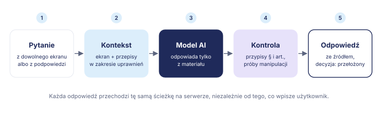

# Sztuczna inteligencja w Busoli

AI w Busoli podpowiada, ale nie decyduje. Odpowiada na pytania o przepisy i zespół, zawsze podając źródło. Ocenę wystawia przełożony.

> **W skrócie**
>
> - **Jedno miejsce na wiedzę o ocenach.** Ustawa, dwa rozporządzenia i poradniki KPRM są dostępne jednym pytaniem, na każdym ekranie.
> - **Odpowiedzi sprawdzalne.** Każde twierdzenie o przepisach ma podstawę: akt i paragraf. Przypisy, których nie ma w materiale, system oznacza ostrzeżeniem.
> - **Bez dostępu „na skróty”.** Asystent widzi tylko te dane, które widzi zalogowana osoba.

## Gdzie działa AI

| Element | Co zyskuje użytkownik | Jak to działa |
| --- | --- | --- |
| **Asystent na każdym ekranie** | Odpowiedź w kilka sekund zamiast szukania w aktach i poradnikach | Model językowy, który odpowiada wyłącznie z bazy przepisów |
| **Wyszukiwanie semantyczne w przepisach** | Właściwy paragraf znajduje się także wtedy, gdy ktoś pyta własnymi słowami | Embeddingi, czyli przepisy zapisane jako wektory znaczeń |
| **Kontekst ekranu** | Asystent wie, którą ocenę i którą osobę oglądasz, więc nie trzeba niczego przepisywać | Serwer dołącza dane z ekranu w zakresie uprawnień użytkownika |
| **Pytania o zespół** | „Kto ma najbliższy termin?”, „Kto jest po terminie?” | Narzędzia, z których model korzysta sam: przegląd zespołu i lista pracowników |
| **Prowadzenie po ekranie** | Zamiast opisu „kliknij tam i tam” asystent przyciemnia ekran i podświetla po kolei to, czego użytkownik potrzebuje w swojej sprawie | Model układa kroki pod pytanie z elementów, które są akurat na ekranie; aplikacja pokazuje je biblioteką driver.js. Do pierwszego użycia przycisk asystenta ma znacznik „Nowe”. Ten sam mechanizm prowadzi stały przewodnik powitalny po zalogowaniu (bez modelu, kroki zapisane w `WelcomeTour.ts`) |
| **Podpowiedzi w kreatorze oceny** | Na każdym z 10 kroków gotowe pytania pasujące do etapu, np. „Ile mam czasu na rozmowę rozpoczynającą?” | Jedno kliknięcie wysyła pytanie do asystenta |

## Jak powstaje odpowiedź

## Na czym opiera się wiedza asystenta

Dziewięć dokumentów, w sumie około 10 tys. wierszy tekstu:

- ustawa o służbie cywilnej,
- rozporządzenia o ocenie okresowej (2016) i o pierwszej ocenie (2015),
- poradniki KPRM o ocenie okresowej i o pierwszej ocenie,
- model kompetencji, wzory arkuszy, przykładowe opisy stanowisk i najczęstsze pytania.

Nowy przepis to nowy plik w bazie wiedzy. Przy starcie aplikacja przelicza tylko zmienione fragmenty. Bez klucza do usług AI asystent nadal wyszukuje przepisy po słowach kluczowych.

## Gdzie AI celowo nie ma

To, co ma skutki prawne, liczą reguły zapisane w kodzie, a nie model. Wynik jest powtarzalny i da się go sprawdzić w przepisie.

| Obszar | Jak jest liczony |
| --- | --- |
| Terminy ocen i etapów | Według rozporządzeń, z kalendarzem dni wolnych i przesunięciem o nieobecności |
| Sugerowany poziom i wynik oceny | Według reguł arkusza (średnia, progi poziomów); przełożony może go zmienić |
| Dane w arkuszu | Uzupełniane z kartoteki pracownika |
| Uprawnienia | Role i zakresy danych sprawdzane na serwerze |

## Bezpieczeństwo i zaufanie

- **Tylko w zakresie uprawnień.** Dane o ludziach serwer pobiera tymi samymi regułami co resztę aplikacji.
- **Brak zgadywania.** Model działa z temperaturą 0 i dostaje przepisy przed każdą odpowiedzią. Gdy materiał nie odpowiada na pytanie, asystent mówi to wprost i odsyła do kadr.
- **Odporność na manipulację.** Historia rozmowy jest podpisana przez serwer, więc nie da się jej podrobić. Wyciek instrukcji jest blokowany. Obowiązuje limit 20 pytań na minutę i 2000 znaków na pytanie.
- **Wymienny dostawca.** Model i dostawcę zmienia się w konfiguracji, bez zmian w kodzie.

## AI przy budowie rozwiązania

Zespół korzystał z asystenta programisty Claude Code (Anthropic) przy pisaniu kodu, przeglądach zmian i dokumentacji. Każdą zmianę zatwierdzał człowiek.
