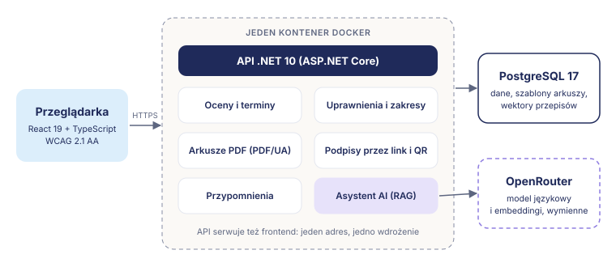

# Technologie i architektura

Jedna aplikacja, jeden kontener, sprawdzone technologie open source. Do uruchomienia u klienta potrzebna jest baza PostgreSQL i obraz Docker.

> **W skrócie**
>
> - **Proste wdrożenie.** Frontend, API i generowanie dokumentów to jeden obraz Docker.
> - **Bez kosztów licencji.** .NET, React i PostgreSQL są darmowe i powszechnie znane na rynku.
> - **Gotowa na zmiany przepisów.** Arkusze ocen to szablony w bazie, a nie kod.

## Stos technologiczny

| Warstwa | Technologia | Dlaczego |
| --- | --- | --- |
| Interfejs | React 19, TypeScript, Vite | Działa w przeglądarce, bez instalacji; zgodny z WCAG 2.1 AA |
| Serwer | .NET 10 (ASP.NET Core) | Wersja z długim wsparciem (LTS), wydajna i typowana |
| Baza danych | PostgreSQL 17, Entity Framework Core | Open source, migracje schematu w kodzie |
| Dokumenty | QuestPDF | Arkusze ocen w PDF/UA: gotowe do druku i czytelne dla czytników ekranu |
| AI | OpenRouter: model językowy i embeddingi | Model i dostawca wymienne w konfiguracji |
| Bezpieczeństwo | ASP.NET Identity, JWT | Role, uprawnienia i zakresy danych (służba, lokalizacja, wydział) |
| Wdrożenie | Docker; demo na Render (Frankfurt) | Ten sam obraz w chmurze i na serwerze urzędu |

## Architektura

- **Modularny monolit.** Moduły (oceny, uprawnienia, PDF, podpisy, AI) mają wyraźne granice w jednej aplikacji. Daje to jedno wdrożenie, jedną bazę i brak kosztów infrastruktury rozproszonej.
- **Uprawnienia na serwerze.** Każde zapytanie, także zapytanie asystenta AI, filtrują te same zakresy danych.
- **Arkusze jako dane.** Wzór arkusza (pola, etapy, terminy, punktacja) to wersjonowany szablon JSON w bazie. Nowy wzór nie wymaga programowania, a oceny w toku zostają przy swojej wersji.
- **Konfiguracja przez zmienne środowiskowe.** Baza, klucze i model AI ustawia się bez przebudowy aplikacji.

## Wdrożenie

| Wariant | Co jest potrzebne |
| --- | --- |
| Chmura | Kontener Docker i zarządzany PostgreSQL. Dane mogą zostać w UE |
| Serwer urzędu (on-premise) | Docker i PostgreSQL w sieci urzędu |
| AI w infrastrukturze urzędu | Model zgodny z API OpenAI, hostowany w UE albo lokalnie. Zmiana jednego adresu w konfiguracji |

## Kierunki rozwoju

| Kierunek | Stan dziś | Następny krok |
| --- | --- | --- |
| Podpis elektroniczny | Podpis odręczny przez link i kod QR | Dostawca podpisu kwalifikowanego (np. Autenti) za istniejącym modułem podpisów |
| Logowanie jednokrotne (SSO) | Własne konta, logowanie JWT | Logowanie przez katalog urzędu (OpenID Connect) |
| Integracja z systemem kadrowym | Pracownicy i nieobecności wprowadzane w aplikacji | Automatyczny import z systemu kadrowego |
| Powiadomienia | Przypomnienia w aplikacji | E-mail lub komunikator urzędu |
| Skala bazy wiedzy | Wektory liczone w pamięci, wystarczające dla tysięcy fragmentów | pgvector w PostgreSQL, bez zmiany reszty aplikacji |
