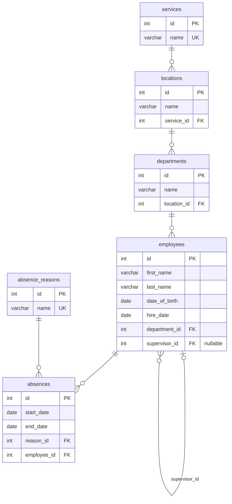

# Backend

.NET 10, EF Core 10, PostgreSQL (Npgsql).

- `Busola.Database` — encje, DbContext, migracje, definicje ról i uprawnień,
- `Busola.Api` — REST API (kontrolery), logowanie JWT, CRUD pracowników, lokalizacji, wydziałów i kont.

## Model danych



| Encja (C#) | Tabela | Znaczenie |
|---|---|---|
| `Service` | `services` | służba |
| `Location` | `locations` | lokalizacja |
| `Department` | `departments` | wydział |
| `Employee` | `employees` | pracownik (lokalizacja i służba wynikają z wydziału) |
| `Absence` | `absences` | dni wolne (zakres `start_date`–`end_date`, obie daty włącznie) |
| `AbsenceReason` | `absence_reasons` | powód dnia wolnego |

Reguły w bazie:
- nazwy w `snake_case` (`EFCore.NamingConventions`), klucze `int` jako identity,
- unikalne: nazwa służby, nazwa powodu, nazwa lokalizacji w obrębie służby, nazwa wydziału w obrębie lokalizacji,
- `CHECK`: `end_date >= start_date`, pracownik nie może być swoim przełożonym,
- usunięcie pracownika usuwa jego nieobecności. Wszystkie pozostałe usunięcia są blokowane, jeśli coś na rekord wskazuje (np. przełożonego z podwładnymi trzeba najpierw przepiąć).

## Uprawnienia

Model jak w PIM: ASP.NET Identity + JWT, tabele `permissions` i `role_permissions`, klucze w `Busola.Database/Authorization/Permissions.cs`, a każdy klucz to polityka (`[Authorize(Policy = Permissions.ReadEmployees)]`). Uprawnienia lecą w tokenie jako claim `permission`. Ponad PIM każda rola ma **poziom widoku** (`roles.scope`), który mówi, *czyje* dane obejmują jej uprawnienia.

| Rola | Zakres (`scope`) | Skąd się bierze | Uprawnienia |
|---|---|---|---|
| `Employee` | `Own`: własny rekord | automatycznie, gdy konto ma pracownika | podgląd pracowników |
| `Supervisor` | `Subordinates`: podwładni bezpośredni i pośredni | automatycznie, gdy pracownik ma podwładnych | podgląd pracowników |
| `Hr` | `Service`: służba użytkownika | przypisana | CRUD pracowników, podgląd lokalizacji i wydziałów |
| `ServiceAdmin` | `Service`: służba użytkownika | przypisana | wszystko w swojej służbie, w tym konta i role |
| `SuperAdmin` | `All` | przypisana | omija sprawdzenia (jak `Admin` w PIM) |

- Uprawnienia użytkownika to suma ról, a zakres liczy się per rola. Np. przełożony, który jest też w HR, widzi całą służbę.
- Służba użytkownika wynika z jego wydziału (pracownik → wydział → lokalizacja → służba).
- Struktura organizacyjna (lokalizacje, wydziały) jest widoczna tylko w zakresie `Service` albo `All`.
- Rola zapisana w tokenie obowiązuje do wygaśnięcia (domyślnie 12 h). Po zmianie ról trzeba zalogować się ponownie.
- `ServiceAdmin` nie może nadać ani odebrać roli o zakresie `All`, a konta bez pracownika zakłada tylko `SuperAdmin`.

Nowe uprawnienie: stała w `Permissions.cs`, wiersz w `PermissionSeed.cs` (kolejne Id), przypisanie do ról, nowa migracja.

## Uruchomienie API

Konfiguracja nie jest w repo. Lokalnie trzymaj ją w user secrets (lub w zmiennych środowiskowych, np. `ConnectionStrings__Busola`):

```powershell
dotnet user-secrets set "ConnectionStrings:Busola" "Host=localhost;Port=5432;Database=busola;Username=postgres;Password=<hasło>" --project Busola.Api
```

```powershell
dotnet user-secrets set "Jwt:Secret" "<losowy ciąg, min. 32 znaki>" --project Busola.Api
```

Pierwsze konto SuperAdmin zakłada się przy starcie, jeśli jest w konfiguracji (hasło: min. 6 znaków, duża i mała litera, cyfra, znak specjalny):

```powershell
dotnet user-secrets set "Seed:SuperAdmin:Email" "admin@example.com" --project Busola.Api
```

```powershell
dotnet user-secrets set "Seed:SuperAdmin:Password" "<hasło>" --project Busola.Api
```

```powershell
dotnet run --project Busola.Api
```

Endpointy (wszystkie poza logowaniem wymagają `Authorization: Bearer <token>`):

| | |
|---|---|
| `POST /api/auth/login` | `{ email, password }` → `{ token }` |
| `GET/POST /api/employees`, `GET/PUT/DELETE /api/employees/{id}` | `GET` przyjmuje `page`, `pageSize` |
| `GET/POST /api/locations`, `GET/PUT/DELETE /api/locations/{id}` | |
| `GET/POST /api/departments`, `GET/PUT/DELETE /api/departments/{id}` | `GET` przyjmuje `locationId` |
| `GET/POST /api/users`, `PUT /api/users/{id}/roles` | konta i role |

Rekord spoza zakresu zwraca 404, a operacja na danych spoza zakresu 403. Naruszenie ograniczeń bazy (duplikat, usuwanie rekordu, na który coś wskazuje) zwraca 409.

## Migracje

Narzędzie `dotnet-ef` jest w lokalnym manifeście, więc najpierw (jednorazowo):

```powershell
dotnet tool restore
```

Connection string bierzemy ze zmiennej `BUSOLA_CONNECTION_STRING`. Domyślnie: `Host=localhost;Port=5432;Database=busola;Username=postgres;Password=postgres`.

```powershell
dotnet ef database update --project Busola.Database
```

```powershell
dotnet ef migrations add <Nazwa> --project Busola.Database --output-dir Migrations
```
